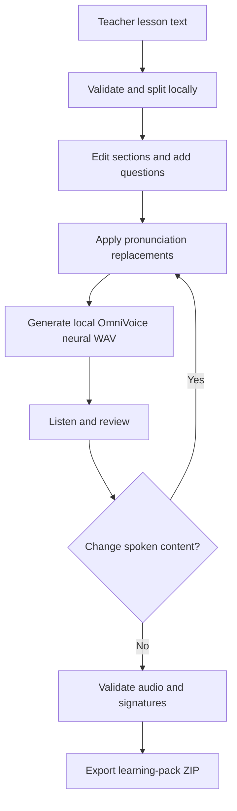

# LessonVoice

**Local noncommercial demonstration:** known upstream dependency advisories remain. Use only trusted text/model files on your own computer; public, LAN and multi-user hosting are not supported. Read [security and dependency limits](docs/SECURITY.md).

**Turn a lesson into a learning pack you can listen to, check and share.**

A local classroom audio studio for teachers. Paste English or Urdu text, split it into editable sections, add pronunciation corrections and your own questions, generate speech, listen, then download a ZIP with WAV files, transcripts, a simple HTML player and an answer key.

LessonVoice uses **strictly offline OmniVoice neural speech**, with four instruction/seed voice-character presets. No cloud speech or robotic fallback is used. Pronunciation and voice identity can vary; listen before sharing, especially Urdu, acronyms and mixed-language text. The app does not translate, invent questions or understand uploaded PDFs.

**Model-use restriction:** the pretrained OmniVoice weights are designated **CC-BY-NC** by their authors; the bundled Higgs audio tokenizer has separate Boson/Meta community terms. This configuration is presented for noncommercial education/research, not as an unrestricted commercial voice service. The application source license does not override those terms. Model weights are downloaded separately and are not included in this repository. Read [third-party notices](THIRD_PARTY_NOTICES.md) before installing or using the speech components.

> Built with Higgs Materials licensed from Boson AI USA, Inc., Copyright Boson AI USA, Inc., All Rights Reserved and Meta Llama 3 licensed under the Meta Llama 3 Community License, Copyright Meta Platforms, Inc., All Right Reserved". based on Meta Llama 3

## Start

The validated host is a **Windows computer with Python 3.12**. Download this repository via **Code → Download ZIP**, extract it, and open a terminal in the LessonVoice folder. Review the model terms above, then install the isolated pinned environment. Allow disk space for the Python packages and approximately **3.3 GB of model assets**, plus several GB of available memory:

```sh
py -3.12 -m venv .neural-venv
.\.neural-venv\Scripts\python.exe -m pip install -r requirements-lock.txt --extra-index-url https://download.pytorch.org/whl/cpu
.\.neural-venv\Scripts\python.exe tools/download_model.py
.\.neural-venv\Scripts\python.exe -m lessonvoice.server
```

Open **http://127.0.0.1:8775**. Keep the terminal running; Ctrl+C stops it. Append `--port 8776` to the server command for a different port. Package/model installation needs internet; inference subsequently loads only local files with outbound connections blocked in the worker. The first generation loads the model and can take longer. No account, API key or paid speech service is used. Other operating systems and GPU acceleration are not claimed as validated by this Windows CPU release. Node.js is optional for JavaScript syntax checking, not the speech runtime.

The tested environment pins `omnivoice==0.2.1`, `transformers==5.21.0`, `torch==2.8.0+cpu` and `torchaudio==2.8.0+cpu`; see [requirements-lock.txt](requirements-lock.txt). The one-time download tool retrieves exact model revision `c5fdb5ccb189668d56333f77ba2629f4cd7535f4` and verifies upstream file hashes and sizes. It is not invoked by an inference request.

## A complete learning pack

1. Load an English or Urdu sample, or paste your own lesson.
2. Split the lesson into sections; edit each heading and text.
3. Choose Warm female, Clear male, Storyteller female or Calm male and preview the voice. These are instruction/seed presets, not cloned people or a guarantee of stable identity. Add literal, case-sensitive pronunciation replacements and preview spoken text; replacements are simultaneous, without cascading.
4. Add your own questions and answer key.
5. Generate audio, listen to every section, and download individual WAVs or the whole pack.
6. Save a draft JSON for later. The current draft also saves in this browser; generated audio stays only in tab memory and must be regenerated after a reload.

Audio becomes stale when spoken content, language, pace or voice character changes. The export endpoint rejects stale signatures, missing sections, malformed audio or truncated WAVs. A signature checks text/settings metadata; it is not a speech-recognition proof of the recorded words. The pace slider is relative: 150 means `1.0×`, 100 about `0.67×`, and 220 about `1.47×`; it does not promise exact words per minute.

**Teacher review:** the ZIP includes answers in `answer-key.txt` and `manifest.json`. Remove both answer locations before giving students a pack where answers should be hidden. Listen for pronunciation errors, particularly Urdu, technical words, acronyms and mixed-language text.

## How it works

The app includes an interactive workflow diagram with optional step highlighting and reduced-motion support. The underlying mechanism:



See [architecture and mechanism](docs/ARCHITECTURE.md), [API contract](docs/API.md) and [release validation](docs/VALIDATION.md).

## Devices and privacy

The interface is designed for phone, tablet and desktop browser widths. **The Python host runs on a computer**; localhost on your phone points to that phone, not your computer. This release does not expose a network server or promise native Android/iOS hosting. Extracted learning packs can be copied to another device; its browser/file manager must support local HTML/WAV playback. Individual WAVs and text transcripts provide portable alternatives.

Lessons go between your browser and the server on your own computer. No cloud TTS, lesson telemetry or lesson-body logging is used. The inference worker uses local model paths, offline flags and blocked outbound socket connections. Eight real CPU sample generations under a connection-denial probe recorded **zero socket attempts**; this is probe evidence, not a claim about unrelated package installation or every platform. Drafts are saved in browser localStorage; use Clear draft on a shared computer and delete downloaded files separately when needed. This is not a secure-erasure guarantee. The service binds to loopback, checks Host/Origin and serves a fixed route list. It has no multi-user authentication and is **not intended for public internet hosting**.

Limits: 20,000 original characters/lesson; 24 sections; 1,500 original and 3,000 spoken characters/section; 30 pronunciation rules and 30 question/answer pairs. Pace: 100–220 relative to a 150 baseline. The neural worker emits mono **24,000 Hz, 16-bit PCM WAV**. Audio is limited to 10 MB/section, five minutes/section and 96 MB/pack. Split long sections if CPU generation times out.

## Test

```sh
.\.neural-venv\Scripts\python.exe -m unittest discover -s tests -v
node --check web/app.js
```

The [validation record](docs/VALIDATION.md) distinguishes automated checks, browser checks, real engine probes and untested platforms. In the recorded eight-sample CPU probe, generation took **18.65–35.34 seconds** for **2.49–4.07 seconds** of audio. These were short English/Urdu samples across four presets, not a real-time benchmark, full-lesson guarantee or perfect-pronunciation evaluation.

## Attribution and license

Created for [Muhammad Ismail](https://www.linkedin.com/in/muhammad-ismail-iqbal/). Research inspiration: [VoiceStudio](https://github.com/debpalash/VoiceStudio)'s local voice-workflow direction. **No VoiceStudio code or models are included.** LessonVoice's addition is the teacher workflow, editable sections, pronunciation review, classroom questions and inspectable learning-pack export.

LessonVoice application source: **GPL-3.0-or-later**, see [LICENSE](LICENSE). OmniVoice library code: Apache-2.0. Pretrained OmniVoice weights: upstream **CC-BY-NC** designation. Higgs tokenizer: Boson Higgs Audio 2 Community License Agreement incorporating Meta Llama 3 terms. These licenses are distinct; neither weights nor tokenizer are represented as GPL. Attribution, official copies and source references are in [THIRD_PARTY_NOTICES.md](THIRD_PARTY_NOTICES.md) and `licenses/`.
