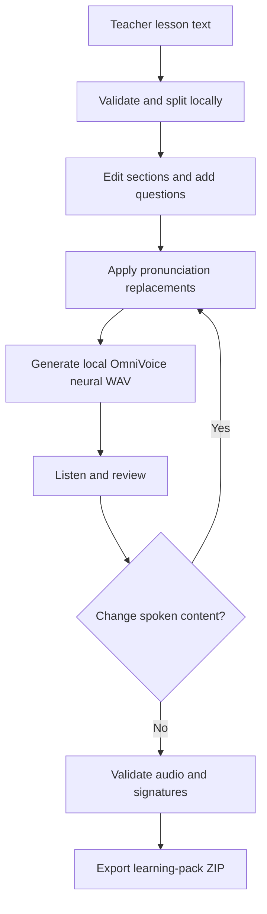

# LessonVoice

**Local noncommercial demonstration:** known upstream dependency advisories remain. Use only trusted text/model files on your own computer; public, LAN and multi-user hosting are not supported. Read [security and dependency limits](docs/SECURITY.md).

**Turn a lesson into a learning pack you can listen to, check and share.**

A local classroom audio studio for teachers. Paste English or Urdu text, split it into editable sections, add pronunciation corrections and your own questions, generate speech, listen, then download a ZIP with WAV files, transcripts, a simple HTML player and an answer key.

LessonVoice defaults to **offline OmniVoice neural speech**, with four instruction/seed voice-character presets. An explicit opt-in ElevenLabs v3 paid API mode is available in Speech engine settings. No automatic provider fallback is used. Pronunciation and voice identity can vary; listen before sharing, especially Urdu, acronyms and mixed-language text. The app does not translate, invent questions or understand uploaded PDFs.

**Model-use restriction:** the pretrained OmniVoice weights are designated **CC-BY-NC** by their authors; the bundled Higgs audio tokenizer has separate Boson/Meta community terms. This configuration is presented for noncommercial education/research, not as an unrestricted commercial voice service. The application source license does not override those terms. Model weights are downloaded separately and are not included in this repository. Read [third-party notices](THIRD_PARTY_NOTICES.md) before installing or using the speech components.

> Built with Higgs Materials licensed from Boson AI USA, Inc., Copyright Boson AI USA, Inc., All Rights Reserved and Meta Llama 3 licensed under the Meta Llama 3 Community License, Copyright Meta Platforms, Inc., All Right Reserved". based on Meta Llama 3

## Start

The validated host is a **Windows computer with Python 3.12**. Download this repository via **Code → Download ZIP**, extract it, and open a terminal in the LessonVoice folder. Review the model terms above, then install the isolated pinned environment. Allow disk space for the Python packages and approximately **3.3 GB of model assets**, plus several GB of available memory:

```sh
py -3.12 -m venv .neural-venv
.\.neural-venv\Scripts\python.exe -m pip install -r requirements-lock.txt --extra-index-url https://download.pytorch.org/whl/cpu
.\.neural-venv\Scripts\python.exe tools/download_model.py
.\.neural-venv\Scripts\python.exe -m lessonvoice.server
```

Open **http://127.0.0.1:8775**. Keep the terminal running; Ctrl+C stops it. Append `--port 8776` to the server command for a different port. Package/model installation needs internet; inference subsequently loads only local files with outbound connections blocked in the worker. The first generation loads the model and can take longer. Offline mode requires no account or API key. Optional paid mode is explained below. Other operating systems and GPU acceleration are not claimed as validated by this Windows CPU release. Node.js is optional for JavaScript syntax checking, not the speech runtime.

The tested environment pins `omnivoice==0.2.1`, `transformers==5.21.0`, `torch==2.8.0+cpu` and `torchaudio==2.8.0+cpu`; see [requirements-lock.txt](requirements-lock.txt). The one-time download tool retrieves exact model revision `c5fdb5ccb189668d56333f77ba2629f4cd7535f4` and verifies upstream file hashes and sizes. It is not invoked by an inference request.


## Speech quality and optional paid API

Listen to the actual updated samples: [English](docs/samples/quality64-en.wav) · [Urdu](docs/samples/quality64-ur.wav). [Browser settings screenshot](docs/speech-settings.jpg).

Model selection: OmniVoice is retained for the combined English/native Urdu requirement and an already installed pinned local runtime. [Qwen3-TTS](https://github.com/QwenLM/Qwen3-TTS) lists ten supported languages without Urdu; it was not substituted for an Urdu product. [Kokoro](https://huggingface.co/hexgrad/Kokoro-82M) is a useful smaller open-weight English candidate, but no Kokoro Urdu capability or local comparative listening win is claimed here. This is a compatibility-based choice, not a benchmark proving OmniVoice is the best sounding open model.


**First choice: local OmniVoice.** The local worker now uses 64 iterative synthesis steps instead of 32, following the [upstream quality/speed guidance](https://github.com/k2-fsa/OmniVoice/blob/master/docs/generation-parameters.md). This costs more CPU time; it is not proof of improved pronunciation on every sentence. Use native Urdu script, normal punctuation, short complete paragraphs, pace 150 (1×), and the pronunciation guide for acronyms/names. Compare a short preview before generating a long lesson. Listen for missing words, repetitions, unnatural pauses and Urdu/English switching. No voice has been certified human-indistinguishable. OmniVoice weights have noncommercial restrictions: open weights do not mean unrestricted commercial use.

If local samples still sound unnatural, **try the optional paid API for potentially better results** and compare the same passage before spending credits on a full lesson. It is not a guarantee that a paid voice is better for your particular Urdu text.

1. Create/sign into an [ElevenLabs account](https://elevenlabs.io/), review current API pricing and obtain API credits. No subscription purchase is made by LessonVoice.
2. In ElevenLabs **Developers → API Keys**, create a key with text-to-speech access. Keep it private; never commit it or put it into lesson text. See [authentication](https://elevenlabs.io/docs/api-reference/authentication).
3. Choose a voice in the ElevenLabs voice library suited to your language/accent and copy its **voice ID**. Account access to that voice is required. This adapter uses `eleven_v3`; check [model language support](https://elevenlabs.io/docs/overview/models) and availability for your account.
4. Start LessonVoice normally and expand **Speech engine settings** below Pace. Select **ElevenLabs v3 · paid API**, paste your key and voice ID, and tick **Allow sending spoken text to ElevenLabs**. Paid mode uses this voice ID; the four local character presets do not select cloud voices.
5. Select English or Urdu and click **Preview this voice**, then play the sample. Every preview/regeneration can consume credits. Paid pace is clamped to 0.7–1.2×; offline pace retains the original range.
6. Generate chapters and download WAV/ZIP as usual. Changing provider, key, voice ID or consent discards prior audio to avoid mixing stale output. Close/reload the tab to forget the key; reselect paid mode and reenter credentials next time. Keys are not included in localStorage, draft JSON, exported packs or server logs.

Only spoken text (after pronunciation replacements), language, pace and voice settings go to ElevenLabs. Questions/answers are not sent unless you put them into a spoken chapter. Your local server relays the request; the browser does not call the provider directly. Offline mode remains the default and never silently calls a paid service. Cloud errors do not fall back to another voice. Check key permissions, credits, voice access and network if generation fails. The app has no billing management or provider retention controls. The adapter requests mono 24kHz PCM and wraps it as WAV; see the [official endpoint](https://elevenlabs.io/docs/api-reference/text-to-speech/convert).

**Validation boundary:** automated adapter tests use synthetic fixtures/mocked HTTP. Actual paid synthesis and listening quality require a user's funded key and have not been certified by those tests. Refer to docs/VALIDATION.md for actual local/browser evidence.

## A complete learning pack

1. Load an English or Urdu sample, or paste your own lesson.
2. Split the lesson into sections; edit each heading and text.
3. Choose Warm female, Clear male, Storyteller female or Calm male and preview the voice. These are instruction/seed presets, not cloned people or a guarantee of stable identity. Add literal, case-sensitive pronunciation replacements and preview spoken text; replacements are simultaneous, without cascading.
4. Add your own questions and answer key.
5. Generate audio, listen to every section, and download individual WAVs or the whole pack.
6. Save a draft JSON for later. The current draft also saves in this browser; generated audio stays only in tab memory and must be regenerated after a reload.

Audio becomes stale when spoken content, language, pace or voice character changes. The export endpoint rejects stale signatures, missing sections, malformed audio or truncated WAVs. A signature checks text/settings metadata; it is not a speech-recognition proof of the recorded words. The pace slider is relative: 150 means `1.0×`, 100 about `0.67×`, and 220 about `1.47×`; it does not promise exact words per minute.

**Teacher review:** the ZIP includes answers in `answer-key.txt` and `manifest.json`. Remove both answer locations before giving students a pack where answers should be hidden. Listen for pronunciation errors, particularly Urdu, technical words, acronyms and mixed-language text.

## How it works

The app includes an interactive workflow diagram with optional step highlighting and reduced-motion support. The underlying mechanism:



See [architecture and mechanism](docs/ARCHITECTURE.md), [API contract](docs/API.md) and [release validation](docs/VALIDATION.md).

## Devices and privacy

The interface is designed for phone, tablet and desktop browser widths. **The Python host runs on a computer**; localhost on your phone points to that phone, not your computer. This release does not expose a network server or promise native Android/iOS hosting. Extracted learning packs can be copied to another device; its browser/file manager must support local HTML/WAV playback. Individual WAVs and text transcripts provide portable alternatives.

Lessons go between your browser and the server on your own computer. Offline mode uses no cloud TTS. Optional ElevenLabs mode sends spoken text to that provider over HTTPS; provider retention and account terms apply. The app does not log lesson bodies or keys. The inference worker uses local model paths, offline flags and blocked outbound socket connections. Eight real CPU sample generations under a connection-denial probe recorded **zero socket attempts**; this is probe evidence, not a claim about unrelated package installation or every platform. Drafts are saved in browser localStorage; use Clear draft on a shared computer and delete downloaded files separately when needed. This is not a secure-erasure guarantee. The service binds to loopback, checks Host/Origin and serves a fixed route list. It has no multi-user authentication and is **not intended for public internet hosting**.

Limits: 20,000 original characters/lesson; 24 sections; 1,500 original and 3,000 spoken characters/section; 30 pronunciation rules and 30 question/answer pairs. Pace: 100–220 relative to a 150 baseline. The neural worker emits mono **24,000 Hz, 16-bit PCM WAV**. Audio is limited to 10 MB/section, five minutes/section and 96 MB/pack. Split long sections if CPU generation times out.

## Test

```sh
.\.neural-venv\Scripts\python.exe -m unittest discover -s tests -v
node --check web/app.js
```

The [validation record](docs/VALIDATION.md) distinguishes automated checks, browser checks, real engine probes and untested platforms. In the recorded eight-sample CPU probe, generation took **18.65–35.34 seconds** for **2.49–4.07 seconds** of audio. These were short English/Urdu samples across four presets, not a real-time benchmark, full-lesson guarantee or perfect-pronunciation evaluation.

## Attribution and license

Created for [Muhammad Ismail](https://www.linkedin.com/in/muhammad-ismail-iqbal/). Research inspiration: [VoiceStudio](https://github.com/debpalash/VoiceStudio)'s local voice-workflow direction. **No VoiceStudio code or models are included.** LessonVoice's addition is the teacher workflow, editable sections, pronunciation review, classroom questions and inspectable learning-pack export.

LessonVoice application source: **GPL-3.0-or-later**, see [LICENSE](LICENSE). OmniVoice library code: Apache-2.0. Pretrained OmniVoice weights: upstream **CC-BY-NC** designation. Higgs tokenizer: Boson Higgs Audio 2 Community License Agreement incorporating Meta Llama 3 terms. These licenses are distinct; neither weights nor tokenizer are represented as GPL. Attribution, official copies and source references are in [THIRD_PARTY_NOTICES.md](THIRD_PARTY_NOTICES.md) and `licenses/`.

## Demo and sharing

[Watch/download the 32-second demo](docs/lessonvoice-update-20261030.mp4) · [Editable video source](docs/video-source/README.md) · [Published LinkedIn caption](docs/linkedin-post.md). The demo shows real browser playback and optional paid settings, with actual English/Urdu 64-step samples. Video is edited for pace, not a generation-speed benchmark. [LinkedIn video post](https://www.linkedin.com/feed/update/urn:li:activity:7521785671770861569/) published and verified on 30 October 2026.
